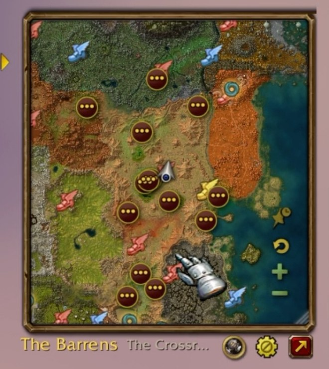
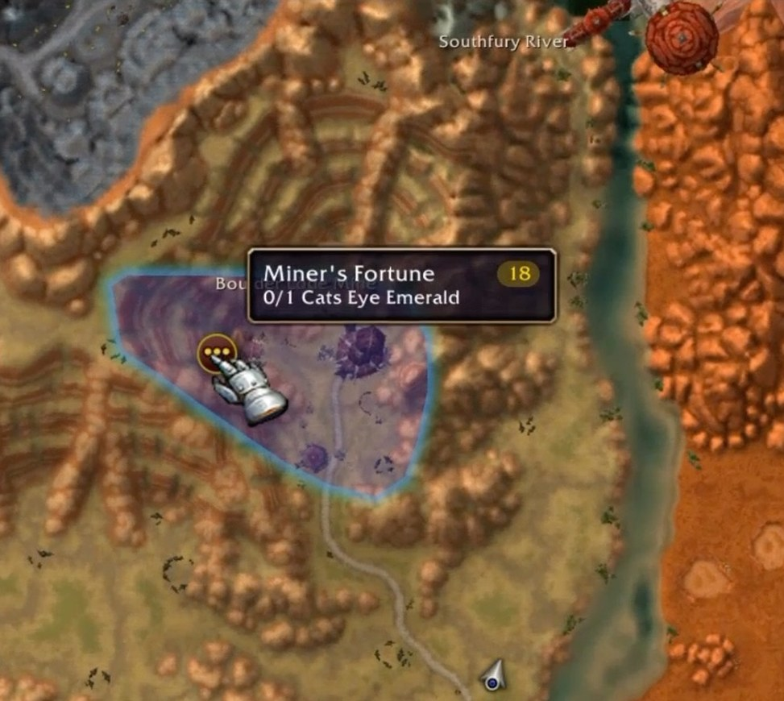
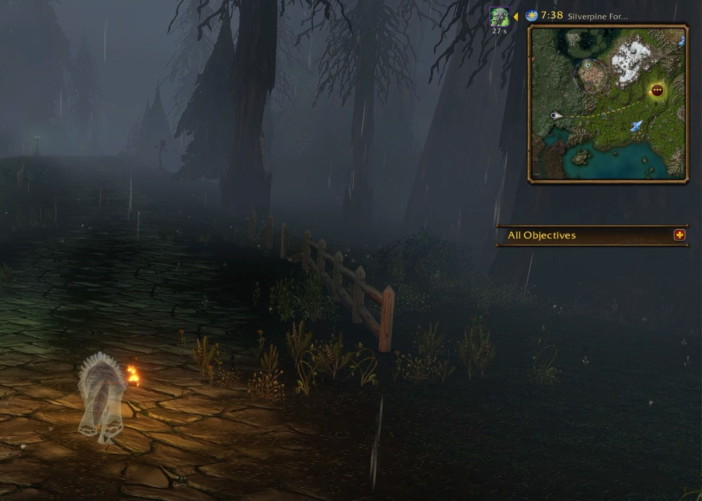

# MagicMap: every feature

The full reference behind the [README](../README.md).

## What it does

**What MagicMap replaces.** The first time you open it (the minimap button, the addon compartment or
`/mm`) a welcome asks what MagicMap should take over, as four cards: **minimap and world map**
(recommended), **minimap only**, **world map only**, or **neither**, opened from the button alone.
Continue saves the choice and opens the map as it says; Escape saves nothing and asks again next
time. Until you answer, nothing of Blizzard's is touched. The choice is two switches in Settings >
General (Replace minimap, Replace world map), live, any time, beside a third the welcome doesn't ask
(Replace quest log, off); `/mm welcome` shows the welcome again.
Players who had 2.0 keep their setup (migrated to both, no welcome).

- *Minimap replaced:* our small map sits on the minimap's spot from login.
- *Minimap not replaced:* Blizzard's minimap stays, and our map is never small: it opens big, and
  closing it hides it. Blizzard's Minimap still draws its blips over our map while it's shown.
- *World map replaced:* M opens our big map. Not replaced: M is Blizzard's world map, as always.
- *Quest log replaced* (Settings > General > Replace quest log): L opens our big map with its quest log
  out (bringing the log back if you'd put it away), and L again closes it. In combat, and while our map is
  switched off, L is Blizzard's. Not replaced: L is Blizzard's quest log, as always.
- *Neither:* nothing of Blizzard's is touched; the minimap button, the addon compartment and `/mm`
  open and close our big map as a window of its own.

**The minimap.** It sits square on your minimap's spot, about 200 yards across, in a metal frame
whose buttons show while you hover. The wheel or + / − zoom it, every notch a step, and the reset
button above + (shown while you're off the default zoom) glides back to it; drag to pan, and left
alone for 6 seconds after a pan it glides back to you (Follow you, in Settings). Move it by the
zone name or the border (or Alt-drag the map), resize it by the corner (it keeps the yards across),
and `/mm reset` puts it back. `/mm`, the rim button or the addon compartment swaps it for
Blizzard's minimap, and back (with the minimap replaced). The minimap button is drawn as other
addons' buttons are (LibDBIcon's shape), draggable round the rim.

<!-- TODO(#9): refreshed screenshot (2.1.0: no zone borders, current tooltip) -->

*The same minimap zoomed out to all of Mulgore, the hover buttons showing: the gear and the big-map
button by the zone name, reset, + and − on the right.*

**The big map (M).** M or the red button grows it into a big map, centred on you; M, the button
or Escape shrinks it. Move or resize the big map and it opens there next time, as the small one does
(`/mm reset` puts both back). The quest log (L) still opens Blizzard's map unless Replace quest log is on in Settings (so does M, with
Replace world map off). The title over the map says what you choose (Settings > Frame title), at rest and with
the pointer on the map, in your order: the zone, subzone, coordinates (the pointer's on the big map), the
tracked target and its distance, the local or server time, each time led by the minimap's own day or night picture in its gold ring (no AM or PM); by
default the zone and the local time, and on hover the zone, subzone, target and its distance. Click the zone name to pick a
continent, another map or an instance; with several zones in view, hover one to light it and click
to fly there. `/mm map` and `/mm zone` do the same by name.

**The quest log on the big map.** Grown, the big map lists your quests down its right side, as Blizzard's world
map does beside its own: each zone a header (click to fold it; folded ones stay folded), each quest's level and name
in its difficulty's colour with what it still needs under it (done: ready for turn-in), under that its rewards in a
line (small item icons, hover one for its tooltip, then the experience and the money), and the count of how many
the log holds. The box puts a quest in Blizzard's tracker or takes it out; a click follows it and flies the map to
its pin (else its zone whole, on its own continent) and opens its details in the panel; hovering lights its area and
shows its tooltip; right-click to see Details, Track, Follow, Share, Abandon or open it in the quest log. The details, as
Blizzard's quest log shows them, take the list's place: its title, Quest Objectives (done ones greyed and ticked),
Description and Rewards (what you choose one of and what you receive, two to a row with their counts and quality
colours, money, experience; hover one for the item's tooltip), with Abandon, Share and Track (Untrack) under them; the
arrow at the top (Back) returns to the list where you left it, as does the quest leaving the log or putting the panel
away. The map narrows to leave room for it; a big window too
narrow for both has none. The chevron at the map's top right puts it away (>) and brings it back (<), as Settings >
Tracking > Quest log does. With **Tracked quests only** (on, same place), a quest you untrack (its box) leaves the
map: its icon, its area and Questie's icons for it; the quest you follow always shows.

*Durotar on the big map: the subzone names, the Valley of Trials' quest areas and pins, and the
walking line up to a waypoint at Razor Hill.*

**The ground.** The game's minimap tiles at any zoom, as Blizzard drew them, on each map's own dark
backdrop; zone and subzone names on the big map (none at the minimap's size; no zone borders: [ADR 0012](decisions/0012-no-borders.md)); your arrow (the Minimap's own player arrow), with a denser shadow. Every pin is Blizzard's art (an atlas, a texture of the client's or its tinted circle); the addon's own files are the map art alone. Under the tiles, a one-picture stand-in for each continent
(Eastern Kingdoms, Kalimdor: zone colours, a crisp coast) shows through wherever the tiles aren't
there yet, so a fast zoom out or a flick never shows bare backdrop. It's never switched over to:
the tiles are the map at every zoom. **The ocean** (Settings > Map > Ocean, on): a coloured sea round
the Eastern Kingdoms, Kalimdor and Zephras Isle, where Blizzard's water is near-black, and the same deep
colour past it. **Map art repairs** (Settings > Map > Repair broken map art, on):
16 places where Blizzard's art is broken, flat unfinished blocks and straight joins in shallow water, are
patched with repaints made with AI image generation from the art round them. Everything else in the tiles
stays the game's own. Off, or on a game build they weren't made for, you see Blizzard's map as it is
([NOTICE.md](../NOTICE.md), [ADR 0011](decisions/0011-ai-map-art.md)).

**Indoors.** In a building, Blizzard's own indoor minimap pictures, placed on our map over the
terrain (dimmed on the small map): the rooms on your floor whole, the floors below faded and those above
ghosted where they overlap yours, the room you're in on top. Your pins, zoom and pan work as outdoors; a
small building (a house, an inn) zooms the small map all the way in as you walk in, and back out as you
leave (Settings > Map > Indoor auto-zoom). The big map has no dimming veil over the terrain. **City
maps**: on the big map in a capital (Ironforge, Orgrimmar, Undercity...), every
building of the city at once, indoors or out, what's underground faded, with the city's own area
names (The Great Forge, the Cleft of Shadow...) among the subzone names.

*Indoors: Undercity's Trade Quarter with its services (grouped into `+2` and `+6` pills), and the
Great Forge in Ironforge by the flight master.*

**Blizzard's blips.** Blizzard's own Minimap draws its blips (herbs, ore, the mailbox, trainers, quest givers'
`!` and `?`) over our map: no ground, north up, centred on you and sized to our zoom, with Blizzard's own arrow.
While the map follows you the wheel and the zoom buttons step through Blizzard's Minimap zooms; zoomed out past
its widest, or in past its closest, the blips hide and the zoom glides. They hide on the big map and while a
path's line is drawn (our arrow and our smooth zoom then). While they show, our flight point and waypoint pins step aside
(Blizzard's own are there). In an instance that hides where you are, Blizzard's
own minimap shows, ground and all. (Since game build 1.60.1.70862 addons can't read the blips, so MagicMap draws
none of its own.) Their tooltips are ours, in our pins' look: a herb or ore led by the icon of what it gives, in
the colour of your skill against it (red, orange, yellow, green, grey) with the skill it needs in a pill beside
it, its profession under it; an NPC's title under its name ("General Goods"), then its quests for you, each in
its difficulty's colour: `!` one to pick up, `?` one of yours to hand in.
**Tracking that stays on**: your gathering tracker (Find Herbs, else Find Minerals, else Find Treasure) or the one
you choose is turned back on after login, a /reload, a loading screen, death or resurrection, waiting out combat
and casts. The game has one tracking spell on at a time, so it's one choice: the gear's Keep tracking. One you
pick yourself in the tracking menu becomes the one kept; one you turn off stays off till the game next drops it.
Blizzard's own flight, quest and POI tracking is
switched off while MagicMap draws those itself, and put back when it stops, even after a crash.

**Quests.** The quests you're on, in Blizzard's icons, with their objective icon, in their difficulty colour;
on the big map each one's name under its pin, in that colour. Quests to pick up and to hand in are Blizzard's own
`!` and `?` blips (above). A quest's tooltip has its facts, what's left to do (the objects an item is in, else
who sells it; not the mobs that drop it) and who to turn it in to. Objective areas are drawn as the game draws
them (its edges and fills); the quest you follow is filled, the rest a quiet edge; hovering an area lifts it
gently. The fills, edges and hover are adjustable in Settings > Quest areas. The tooltip is compact: one row of
facts with the level in its difficulty colour, a `?` icon before who takes the quest in.
**The quest pill** at the bottom left shows what you track: the quest you follow (or your waypoint, the icon you
track, your corpse). By default it says the quest's progress, then the yards to it, smaller and muted (its name
and the time to arrive on offer; the pieces and their order on Settings > Quest pill), on a dark rounded track
in a thin bronze frame, filled (gold by default) by how far you've come since you began going to it. The `×` at
its end stops it: unfollows the quest, or stops tracking or pathing. With nothing tracked it's hidden.

<!-- TODO(#12): refreshed screenshot (2.1.0: no zone borders, current tooltip) -->

*A quest's tooltip in the Valley of Trials: its level, the objective's count, who to turn it in to.*

**Where to go.** Your target is your corpse while you're a ghost, else the quest you follow, else
your waypoint. **Click any icon** (left or right; your waypoint's own too): its tooltip grows into a small popup
with a row of buttons, Track and Path to (each Stop tracking or Stop pathing while it's what that icon has; each
names itself on hover). Either sets the game's waypoint at the icon, and the title and the quest pill go to it;
what you track is never grouped into a pill and shows at any zoom. A quest icon's Track and Path to follow the
quest, and a third button opens its details in the big map's quest log (growing the map, and bringing the log back if
you put it away; Blizzard's when the window is too narrow for it); your waypoint's own has Clear waypoint. The two are exclusive:
choosing one replaces the other. The popup stays till you pick, click off it or press Escape.
**Track** shows the way with Blizzard's gold arrow alone, placed by the walk to the target (around cliffs, lava
and water): it stands along that way a short distance from you (96 px by default), pointing along it, so a
route that turns north first points north; it comes in as you near the target, settles beside its icon and fades
as the icon takes over. It eases round as the way changes, and your turning doesn't move it. Its size, opacity
and distance are in Settings > Tracking.
**Path to** draws the walk as a thin, quiet gold dashed line, leaving your arrow on a lazy lead-in and turning
corners in rounded bends, to a quest area's nearest edge; off the map, a gold arrow on the edge points the way.
At the minimap's size the map pans and zooms to keep you, the target and the way between in view, zooming in
steadily as you near it, as far as the map goes (the big map is left where you have it); pan or zoom yourself and it comes back once left alone, as Return to you does (Settings >
Tracking > Frame the way). The line's style (dotted, dashed, solid),
weight, colour, glow, breathing, opacity and outline are in Settings > Pathing. Your corpse always gets the line,
and the view comes back to you.
**Arriving** finishes it: within 5 yards of the target (or inside a quest's area), the arrow and the line go,
and a waypoint (or the icon tracked on it) is cleared; a quest stays followed. Both stay through a /reload. While you follow a quest, the quest pill is its icon: hover it for the quest's
tooltip, click it for its popup; its `×` stops it. Clicking a quest's area follows it (Track).
Ctrl-click sets the game's waypoint (Ctrl-right-click clears
it), Shift-click opens chat with a `/way` line, and right-click off an icon offers both. While the map is off its default (you dragged it, flew to a zone or zoomed),
the gold reset arrow above the zoom buttons glides back to you. The mode button (Blizzard's red expand) turns to
its condense on the big map. On the big map, right-click leads with what's there: zone, subzones, coordinates, level
range against yours, distance, quests, explored or not, and the landmarks nearby.

**The Map Pin button.** On the big map, left of the quest log's chevron, Forever's Map Pin toggle (hover for its tip):
click it to arm it (it stays lit), then click the map to put the waypoint there, as Ctrl-click does, without the map
panning; it disarms itself after the click. A right click, the map shrinking or the button again disarms it too. Not
where there's no zone's map: the press stays the map's and the button armed.

**Pinging the minimap.** MagicMap's small map sits over Blizzard's Minimap, so a click on it would never ping. Now a
click on the small map over you (a click nothing else took: not a drag, an icon or a quest's area) pings the Minimap
at that spot, as Forever's own Minimap does on a click, only inside its radius. A ping (yours or a group member's)
shows on the map, big or small, for three seconds: rings spreading and fading from the spot, the pinger's name under
it in their class colour. While Blizzard's own Minimap is seen over the small map, the client draws its ping.

<!-- TODO(#12): refreshed screenshot (2.1.0: no zone borders, current tooltip) -->

*Following The Adventurer at Camp Narache: the line to the turn-in's `?`,
"ready to turn in" in the quest pill.*

**Places and people.** Flight points, dungeon entrances, points of interest and graveyards (off until
you turn them on in the gear menu); party and
raid members in class colours; rares you've seen, remembered for every character on your account;
the rares and treasures the game shows now; your corpse and waypoint.

**Crowded icons.** Where icons overlap they group into a small pill of up to two icons (`+N` for
the rest, sized to its digits); click it for a grid of them all, each with its own tooltip and click
Quest icons are never grouped, and nothing groups at the minimap's size.

**Other addons.** World-map pins added through HereBeDragons (Questie, HandyNotes...) show on the
map with their own icons, tooltips and clicks, each addon a row in the gear's Other addons, over
Blizzard's blips so their tooltips work; on the big map only zoomed in to about two zones across. Their
minimap pins (GatherMate...) show around you. Nothing is drawn twice.

**The gear menu** (by the zone name): **Map**, the layers in one list with an "All" box on top and its n/total
in its name: zone labels; quests and quest areas; flight points, dungeons and raids, graveyards (off until you
turn them on) and points of interest; rares and treasures, and party and raid. **Tracking**: Blizzard's tracking
types, as Blizzard's own menu has them. **Keep tracking**: the tracker kept on (each tracking spell you know, or
Off). **Other addons**: a row each for the addons whose pins show. Then Use Blizzard's minimap (while ours replaces
it) and Reset to defaults, then Settings.
**The AddOns button** (left of the gear, shown while you point at the map, in the look of an addon's minimap
button): the buttons the minimap's rim would hold, hidden with Blizzard's minimap (LibDBIcon's addon buttons, the
addon compartment's, other addons' rim buttons, then Blizzard's calendar and clock), each a row with its icon that
clicks it (right-click too) and shows its tooltip.

**Settings.** A window of its own (the gear's Settings, `/mm feel` or `/mm settings`, or Game menu >
Options > AddOns > MagicMap > Open MagicMap Settings), a sidebar of pages with the chosen one beside it (the last is
remembered), each page's settings under small headers. The client's own controls: sliders with their value beside
them and a step button either side, checkboxes, dropdowns, colour swatches with Custom… (the game's colour picker:
any colour). Every change applies at once. A setting changed from its default shows an undo mark (a click puts it
back), each page has its own Reset and there's Reset all at the bottom, each lit only while there's something to
reset; the switches (what MagicMap replaces, Follow you, the minimap button, the diagnostics) are left
as they are. A row that only matters while another setting is on (the outline's colour, the breath's pace) shows
only then; a row with more under it (Pins' families and types) has a plus that opens it. Hover a row for what it does and its default. Settings are account-wide.

| Page | Settings (default) |
| --- | --- |
| General | Blizzard's maps: Replace minimap, Replace world map (what the welcome chose), Replace quest log (off: L opens our big map with its quest log, and closes it), Minimap button (on). Map window: Buttons at rest (0%: the buttons show while you point at the map), Border (Metal: the client's frame, the default; Tooltip: Blizzard's chamfered tooltip edge, grey, over a dark backing, as unit-frames draws; switched live, the map, its buttons and the grip move to its edge), Reset window position. Movement: Follow you (on), Return to you (on: the small map glides back to you when left alone), Return after (6 s), Zoom per notch (+30%: where Blizzard's minimap has no zoom of its own) |
| Map | Names: Label size (100%), Zone name opacity (95%), Subzone size (100%), Subzone opacity (55%). Ground: Ocean (on), Repair broken map art (on). Indoors: Indoor dimming (65%), Indoor auto-zoom (on). You: Your arrow (100%) |
| Title | At rest (Zone, Local time), On hover (Zone, Subzone, Tracked target, Distance to target), each chosen and ordered from Zone, Subzone, Coordinates, Tracked target, Distance to target, Local time, Server time (each time led by the day or night picture). Format: Clock (as Blizzard's clock / 24-hour / 12-hour; shown while a time is chosen) |
| Pins | Show pins (on), Pin size (120%), Pin opacity (100%). By type: each family (Quests, Rares & treasures, Party, Places, Addons, Other) shown or not, and opened (+) its Size (Pin size's; Party's 100%, its own) and Opacity (Pin opacity's); each pin type under its family, with its icon drawn as on the map: shown or not, and opened its Size, Opacity, Icon (Blizzard's other art for it, today's by default) and Group (whether it may stand in a group's pill). Each follows the level above until set; its undo hands it back |
| Quest pill | Shows (what you track / off), Says (Objective progress, Distance; chosen and ordered from those, Name and Time to arrive), Progress bar (on), Bar opacity (60%), Bar colour (Gold). Look: Backing (35%), Size (90%) |
| Pill layout | Pill: Height (20 px), Padding (4 px), Icon size (10 px), Icon spacing (2.3 px). Text and close: Text size (9), Text spacing (5 px), Close spacing (5.4 px), Close opacity (35%). Border: Border size (45%), Border opacity (85%) |
| Tracking | Arrow: Size (105%), Opacity (100%), Distance (96 px). Path to: Frame the way (on). Tracked icon: Glow (on), Glow size (200%), Glow opacity (100%). Quest log: Tracked quests only (on: an untracked quest's icons, area and Questie's icons off the map), Quest log on the big map (on; the chevron on the big map too) |
| Pathing | Line: Style (dashed), Weight (1.4 px), Colour (Gold), Opacity (65%). Effects: Glow (off), Breathing (off), Breath pace (1.8 s). Outline: Outline (off), Outline colour (Dark) |
| Quest areas | Followed quest, Other quests: Fill, Edge, Edge width. Under the cursor: Fill lift, Edge (as the game draws them, a quiet fill by default) |
| Diagnostics | Debug info in title. Reports in chat: Record 10 seconds; Compare with other addons; Memory breakdown (each also a `/mm` command) |

## Commands

| Command (`/mm` or `/magicmap`) | Does |
| --- | --- |
| `/mm` | MagicMap or Blizzard's minimap |
| `/mm follow` | Follow you, or stop |
| `/mm map <name or id>`, `/mm zone <name>` | Show a map (alone: list them); fly to a zone |
| `/mm reset` | Back onto the minimap's spot, at its size |
| `/mm layers`, `/mm layer <name>` | What's drawn; show or hide one layer |
| `/mm icon` | The minimap button |
| `/mm minimap ours`, `/mm minimap blizzard` | Who has the minimap while our map is shown |
| `/mm feel`, `/mm settings`, `/mm welcome` | The settings window; the first-run welcome again |
| `/mm mark <note>` | Note something for the bug report (saved at `/reload` or logout) |
| `/mm landmarks`, `/mm indoor`, `/mm overlay` | Rares remembered; the building and room you're in, as you move (again: off); where Blizzard's Minimap sits over the map |
| `/mm help` | Every command, the diagnostics too (`perf`, `errors`, `check`...) |

## Limits in detail

- **WoW Forever only** (installed under `World of Warcraft/_forever_/`), the client build `Data/` was
  generated from, 1.60.1.70862 (a patch means regenerating).
- **Blizzard's blips** show only around you, as far as Blizzard's Minimap sees (about 230 yards at its widest),
  and not on the big map or while a path's line is drawn.
- **Indoors** only buildings with Blizzard's indoor minimap pictures get them; elsewhere the terrain.
- **Instances** that hide your position show Blizzard's own minimap, ground and all.
- **Rotate Minimap**: MagicMap stays north up, and other addons' minimap pins hide while it's on.
- **Other minimap addons** (SexyMap, square-minimap addons) may conflict. While FarmHud has the
  minimap, MagicMap leaves it to FarmHud.
- **enUS** names only; no routes beyond walking; no per-character profiles
  ([v1-non-goals.md](v1-non-goals.md)).

